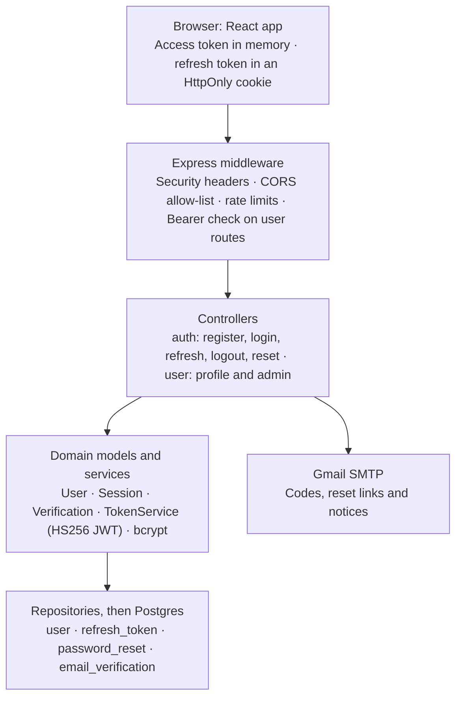

# Treasure Authentication: Design Doc

Last updated: 2026-11-26

## Overview

Treasure ships username-and-password accounts with short-lived access tokens, rotating refresh tokens, email-verified sign-up and link-based password reset. It is a boilerplate: the auth layer should be safe to inherit as-is, and easy to extend with roles, OAuth or MFA later.

**Goals**

- Accounts can only be created for an email the person controls.
- A stolen access token is useful for at most 15 minutes; a stolen refresh token is detected on reuse.
- Changing or resetting a password signs out every other session.
- Endpoints don't reveal which emails have accounts, and no third party can lock an owner out.

**Non-goals for now**

- Social login (OAuth), single sign-on and multi-factor authentication. The roadmap covers where they would plug in.
- Multi-instance deployment: the per-IP rate limits live in process memory.

## Architecture

Requests pass four layers, and only the repositories touch Postgres.

Each layer calls only the one below it. Controllers send email through Gmail SMTP without waiting on it for password resets and notices.

## Tokens and sessions

A session is a server-side refresh-token record. The browser holds a 15-minute access token in memory and a 7-day refresh token in a cookie.

| Token | Lifetime | Where it lives | Revocable |
| --- | --- | --- | --- |
| Access token (HS256 JWT, `type: access`) | 15 minutes | Browser memory, sent as `Authorization: Bearer` | No, it expires |
| Refresh token (HS256 JWT, `type: refresh`, `jti` = record id) | 7 days from its last use | HttpOnly, SameSite=Strict cookie scoped to `/api/auth`, Secure in production | Yes, via `refresh_token` |

- **Verification.** The `auth` middleware verifies the access token once and sets `res.locals.userId`. Controllers and models work with that user id and never see the token.
- **Rotation.** Only refresh tokens rotate. Every call to `POST /api/auth/refresh-token` marks the current refresh token rotated and issues a new one along with a new access token.
- **Reuse detection.** A rotated refresh token presented more than 30 seconds after rotation is treated as stolen, and all of that user's sessions are revoked. Within 30 seconds it still returns an access token, so tabs refreshing at once don't sign each other out.
- **Revocation.** Logout revokes the current session. A password change, a password reset or deleting the account revokes every session; a password change keeps the browser that made it. Changing the email does the same as a password change: every other session is revoked, and the old address is notified.
- **Expiry gap.** Access tokens aren't tracked, so one issued before a revocation works until it expires, at most 15 minutes.
- **Status check.** `GET /api/auth/status` reports whether each token is present and valid, without changing anything or returning the tokens.
- **Frontend.** On a 401 the API client refreshes once and retries the request. Concurrent requests in a tab share one refresh.

## Registration and login

Sign-up proves email ownership with a 6-digit code before the account exists; login takes a username and password and starts a session.

1. `POST /api/auth/create-verification-email` creates or replaces the 6-digit code for the address and emails it. Codes last 10 minutes.
2. `POST /api/auth/register` takes username, email, code and password. It checks formats, rejects a taken email or username, checks the code, then creates the user and deletes the code in one transaction.
3. `POST /api/auth/login` checks the password against its bcrypt hash, returns an access token and sets the refresh cookie.

**Email verification codes**

| Rule | Value |
| --- | --- |
| Lifetime | 10 minutes, checked at registration and email change |
| Submissions per code | 5, right or wrong; the 5th wrong one locks the code until a new one is sent |
| Codes per address | 3 per hour (HTTP 429 after that) |
| Requests per IP | 10 per hour |
| Comparison | Constant time; each submission is counted before comparing, so simultaneous guesses get no extra tries |

Each address has one code row that a new request updates in place. Expired and locked codes keep their row, so neither can reset the hourly count.

**Login**

- An unknown username and a wrong password both return `Invalid username or password` and take the same time: an unknown username is still checked against a dummy bcrypt hash.
- 5 failed logins per username and IP every 15 minutes, then HTTP 429. Successful logins don't count, and keying by IP means strangers can't lock the owner out.
- A username or password that isn't a non-empty string gets the same 400 before any query.

**Rules**

| Field | Rule |
| --- | --- |
| Username | Starts with a letter; letters, digits and underscores; 3 to 21 characters |
| Password | 8 to 72 printable ASCII characters, no spaces; at least one lowercase letter, uppercase letter, digit and symbol (any of the 32) |
| Email | Basic `name@domain.tld` shape; trimmed and lowercased everywhere, and the database rejects any email that isn't lowercase |

Passwords are hashed with bcrypt at `SALT_ROUNDS`, asynchronously so hashing doesn't block the server. 72 characters is the most bcrypt uses.

**Email change** needs the current password, a code sent to the new address, an unexpired code, and an address no other account uses. Afterwards it signs out every other session and emails the old address, with the new one partly hidden.

**Admin routes** (listing, searching and deleting users) run `requireRole(Role.Admin)` after `auth`. It reads the role from the database on each request and answers 403 without it, or 401 if the account no longer exists.

## Password reset

Reset uses a one-time emailed link carrying a 256-bit token, so guessing is infeasible and no per-account attempt limit (and no lockout) is needed.

1. `POST /api/auth/create-password-reset` checks the email's format, then always returns the same message: "If an account uses that email, a password reset link has been sent." It responds before looking the account up, so existing and unknown emails answer equally fast.
2. For an existing account, the server creates a token with 32 random bytes, stores only its SHA-256 hash, and emails `APP_BASE_URL/password-reset#token=<token>`. The base URL comes from server config, never the request.
3. The page reads the token from the URL fragment (which browsers never send to servers or in `Referer`) and removes it from the address bar.
4. `POST /api/auth/reset-password` with `{ token, newPassword }` looks up the hash, checks expiry and that the account still has the email the link was sent to, sets the new password, deletes every reset token for the account, revokes all sessions, and emails a "your password was changed" notice.

| Rule | Value |
| --- | --- |
| Link lifetime | 30 minutes |
| Uses per link | 1 (enforced in a transaction, so two concurrent submits can't both succeed) |
| Reset emails per account | 3 per rolling hour; extra requests get the same response and send nothing |
| Reset requests per IP | 5 per hour |
| Earlier links after a new request | Stay valid, so a third party can't cancel the owner's link |
| Email changed after sending | Link stops working |
| After a reset or a password change | The account's email gets a notice linking to the reset page |

Emails are sent without making the request wait, and a failed send is logged with the user's id, never their email address.

## Rate limiting and abuse protection

Five limits protect the API; each over-limit answer is HTTP 429 with a `Retry-After` header.

| Limit | Keyed by | Allows | Stored in |
| --- | --- | --- | --- |
| All `/api` routes | IP | 100 requests per 15 minutes | Memory |
| Failed logins | Username and IP | 5 failures per 15 minutes; successes don't count | Memory |
| Password reset requests | IP | 5 per hour | Memory |
| Verification email requests | IP | 10 per hour | Memory |
| Emails per address | Account or address | 3 reset emails and 3 verification codes per hour | Database |

- Memory limits reset on restart and aren't shared between instances; a shared store such as Redis is needed before running more than one.
- They assume no reverse proxy. Behind one, Express must trust only that proxy before client IPs mean anything.
- The database limits survive restarts, and simultaneous requests can't exceed them.

**Browser protections**

- `helmet` sets security headers on every response, including a Content-Security-Policy that allows scripts, styles and requests only from the app's own origin and images from S3, which blocks injected scripts and data theft.
- CORS allows only origins in `ALLOWED_ORIGINS`, with credentials. It does nothing in the default setup, where the browser only makes same-origin requests.
- The refresh cookie's SameSite=Strict and `/api/auth` path keep it off cross-site requests and every other route; other API routes need a Bearer header the browser never adds by itself.
- Uploaded photos get a server-generated name and an image extension, are limited to JPEG, PNG, WebP and GIF on disk, and are capped at 5 MB.

## Data model

Four Postgres tables hold auth state, managed by Drizzle migrations in `backend/src/infra/db/migrations`.

| Table | Columns | Notes |
| --- | --- | --- |
| `user` | id, username (unique), email (unique), password (bcrypt hash), role (`admin` or `user`, default `user`) | A check constraint requires lowercase email |
| `refresh_token` | id, user_id (FK, cascade delete), expires_at, rotated_at | One row per session; indexed on user_id. Rotated rows stay until they expire, for reuse detection |
| `password_reset` | id, user_id (FK, cascade delete), email, token_hash (unique), created_at, expires_at | Index on (user_id, created_at) for the hourly cap |
| `email_verification` | id, email (unique), code, expires_at, attempts, send_count, send_window_started_at | One row per email, updated in place; tracks guesses per code and sends per hour |

A cleanup job runs at start-up and every hour, deleting rows past their `expires_at`. It keeps rotated refresh tokens until they expire and verification rows until their send window ends, so cleanup can't weaken reuse detection or reset a send count.

Migrations, oldest first:

| Migration | Change |
| --- | --- |
| `silky_namorita` | Initial schema |
| `volatile_earthquake` | Refresh tokens, reset attempts, user_id on resets |
| `broken_monster_badoon` | Drops 6-digit reset codes and the attempt table |
| `rich_hellfire_club` | Reset link-token columns |
| `safe_silk_fever` | Index on `refresh_token.user_id` |
| `youthful_thunderbolt` | Foreign key from `refresh_token` to `user`, after removing orphaned sessions |
| `young_franklin_storm` | Lowercases emails and adds the lowercase check |
| `burly_tattoo` | Guess counter on verification codes |
| `cultured_dragon_lord` | One verification row per email and the hourly send count |

## Configuration

The backend refuses to start if any auth setting below is missing; they live in `backend/.env.<NODE_ENV>`.

| Variable | Used for |
| --- | --- |
| `JWT_SECRET_KEY` | Signs access and refresh tokens (HS256). Must be at least 32 characters or the backend won't start; generate one with `openssl rand -hex 32` |
| `SALT_ROUNDS` | bcrypt cost for password hashes |
| `APP_BASE_URL` | Address users open the app at; reset links point here |
| `ALLOWED_ORIGINS` | Comma-separated origins allowed by CORS |
| `GMAIL_ADDRESS`, `GMAIL_APP_PASSWORD` | Sends verification and reset emails |
| `NODE_ENV` | `prod` or `production` makes the refresh cookie Secure |

Rotating `JWT_SECRET_KEY` signs everyone out, because every existing token fails verification.

## Known gaps and roadmap

All five security gaps from the first review are fixed. What's left is hardening for larger deployments and features a boilerplate usually includes.

**Fixed**

| # | Gap | Fix |
| --- | --- | --- |
| 1 | Changing the email needed no current password | Email change requires the current password, an unexpired code, and an address no other account uses |
| 2 | 6-digit email codes could be guessed without limit | 5 submissions per code, 3 codes per address per hour, 10 requests per IP per hour |
| 3 | Login allowed guessing and revealed which usernames exist | One generic error, equal timing through a dummy bcrypt check, and 5 failures per username and IP every 15 minutes |
| 4 | Verification emails could be sent to any address without a cap | 3 per address and 10 per IP per hour. Sign-up still says when an email is already registered, by choice |
| 5 | Emails were compared case-sensitively | Emails are trimmed and lowercased everywhere, and the database enforces it |

Also fixed: async bcrypt; a password rule that allows all common symbols, rejects spaces and caps at 72 characters; security headers with a Content-Security-Policy; a foreign key and index on `refresh_token`; the hourly cleanup job; hardened uploads; no emails or usernames in logs; access tokens checked once, in middleware; email change signing out other sessions and notifying the old address; a 32-character minimum for the JWT secret; a `requireRole` middleware on admin routes; and error messages that no longer repeat back the username, email or code that was sent.

**Still open**

- Sign-up reveals whether an email is registered. That's kept on purpose; an app where having an account is itself sensitive should hide it.
- Guessing spread across many IP addresses is only slowed per IP. A per-account cap across all IPs, or a second factor, would be the next step.
- In-memory rate limits need a shared store such as Redis before running more than one instance, and `trust proxy` must be set behind a proxy.

**Then: boilerplate features**

- [ ] "Sign out everywhere" and a list of active sessions, built on the `refresh_token` table.
- [ ] A notification email for new sign-ins. Password and email changes already send one.
- [ ] Account deletion that asks for the password.
- [ ] Sign in with email as well as username.
- [ ] Branded email templates. The sender is still `"Your App" <no-reply@yourapp.com>`.
- [ ] Extension points when needed: OAuth providers through an account-links table, TOTP multi-factor, and an audit log of auth events.
